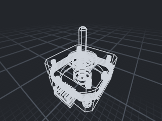
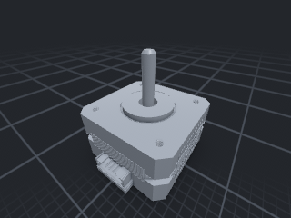
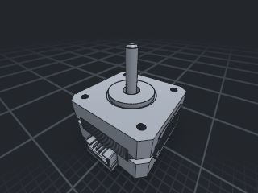
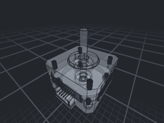

# Native viewport rendering qualification

This is code-coupled local test evidence for the four rendering styles, recorded
on 2026-10-18 from the uncommitted implementation worktree. It is not a project
backlog, an accepted appearance baseline, production cutover, or workflow-parity
claim. Plane remains the project-management authority.

## Implementation under test

`onecad-render::Renderer` is the shared native/headless CAD renderer. The legacy
React/Tauri application, comparison adapter/vendor, and executable rendering
prototypes have been retired. Shared application services and the OCCT worker
remain. The existing native UI/navigation are retained; no display-mode controls
were added. Invalidated legacy visibility/opacity controls were removed.

`RenderOptions::display_mode` selects Wireframe, Shaded, ShadedEdges (default), or
Xray. X-ray defaults to 0.25 surface opacity and 0.22 hidden-edge opacity. It
requires negotiated `FLOAT32_BLENDABLE`; unsupported changes reject before
publication. Both negotiated depth/stencil formats use reversed-Z.

MESH1 sections 14–16 carry optional edge classes and zero-based incident-face
ordinals. Worker classification uses OCCT continuity with a 0.001 rad display
angle. Old meshes remain valid and display unknown edges conservatively. Fresh
classified NEMA geometry retains 381,524 triangles and 67 bodies. The older
fillet fixture remains available for legacy compatibility coverage.

Missing nondegenerate face triangulation now rejects partial mesh publication.
A reproduced compound containing a box and an unmeshed face previously passed
OCCT's `IsDone()` check and published an incomplete body. The production
Tessellate dispatcher now returns `OP_FAILED` with `detail.bodyId`, without any
partial attachments. Plan artifact generation reports the existing tessellation
warning while preserving the authoritative body. Degenerate-only faces retain
their empty topology row. Native mesh/admission errors retain the prior drawable
publication and reject stale actions.

## Local validation

| Check | Result |
| --- | --- |
| `ONECAD_REQUIRE_WORKER=1 ONECAD_WORKER_PATH=$PWD/worker/build-native/onecad-worker cargo test --workspace` | 1,973 passed; 0 failed; 7 explicitly ignored |
| Fresh worker mesh interoperability, run explicitly with `ONECAD_MESH_FIXTURES=$PWD/fixtures/render/edge-policy` | 1 passed |
| `ctest --test-dir worker/build-native --output-on-failure --parallel 3` | 207 passed; 0 failed |
| `cargo test -p onecad-render -- --ignored --nocapture --test-threads=1` on Apple M4 Pro / Metal | 6 passed; 0 failed; 88.25 s |
| `cargo clippy --workspace --all-targets -- -D warnings` | Passed |
| `cargo fmt --all --check`, `git diff --check`, `npx --no-install tsc --noEmit` | Passed |
| Native release bundle | Signature, worker selftest, embedded worker hash, and 51-file Mach-O linkage audit passed |

The seven default ignores are the six hardware tests and one external-mesh
interoperability test; all seven were run explicitly above. Backend migration
preserved 42 top-level suites, 49 Rust files including support modules, and one
STEP fixture. The 911 application tests are included in the workspace total.

The first workspace run caught the interim native-menu regression. The final
workspace run above used corrected submenu behavior; the host suite includes 90
passing tests, including real synthetic pointer selection of XY and 2× SSAA.

Hardware assertions include every box topology edge (rear wires included),
wireframe face/preview interiors without fills, classified seam/tangent
suppression, shaded-only base-line suppression, geometry-buffer reuse, repeated
highlight replacement/clear accounting, nested and intersecting transparent
bodies, 128-body / 282,624-triangle overdraw, opacity endpoints, and opaque output.
Full-image RGB comparisons, including alternating selected bodies, remain within
2/255 after reversing submission. Selected line groups draw after ordinary lines
so interaction color does not depend on body submission order.

Section tests cover synthetic contours, coplanar/nested cuts, one cap
contribution, preview caps/silhouettes, selection/hover, both themes/projections,
1.25 fractional DPI, and 1×/2× SSAA. Preview cap-center blending uses a declared
0.015 linear RGB tolerance. Existing section depth probes use 0.001 tolerance.
Mode captures require substantial coverage; NEMA shaded model regions must change
more than 10,000 pixels relative to the same empty-scene grid. Some older
feature-presence checks still use eight pixels and do not establish appearance
acceptance on their own.

## NEMA measurements

Measurements use the same fixed fitted camera and classified geometry across all
four modes, both themes, and both projections, at 320×240 output. Debug CPU
preparation took 7.043725084 s. Prepared CPU charge was 34,842,528 bytes; geometry
was 31,086,848 bytes; targets were 16,394,240 bytes; the accounted replacement peak
was 186,416,608 bytes. These portable payload estimates exclude process RSS,
toolkit memory, and driver/compiler allocations. The unchanged 64 MiB host
preparation cap and 500,000-triangle per-scene admission limit remain in force.

One representative perspective/dark warm-frame completion sample per mode:

| Mode | Encode, submit, and GPU completion |
| --- | ---: |
| Wireframe | 17.381459 ms |
| Shaded | 8.710625 ms |
| ShadedEdges | 17.423625 ms |
| Xray | 38.597750 ms |

These samples exclude readback but include CPU encoding, submission, and
completion polling. They are not isolated GPU timings, application input/frame
budgets, sustained navigation FPS, or 1M/5M-triangle qualification.

The following images are static review evidence from that run, not accepted
goldens. Tests do not consume them. They were copied without image processing.

| Wireframe | Shaded | ShadedEdges | Xray |
| --- | --- | --- | --- |
|  |  |  |  |

## Native and bundle observations

The final signed bundle was built at
`/private/tmp/onecad-four-modes-release/OneCAD.app`. Its worker SHA-256 is
`4cf8e6c1b5e45de4c997409c7958ca87793ee96d4b18eaa31c2ccfc9864350b5`, matching the
embedded manifest. OCCT fingerprint is `0a6a1dce34181289`; the worker selftest
reports OCCT 8.0.1. The final host SHA-256 is
`92031635017e78f489d5865314ded5cdff5bff4edc74b4f30c9d1e7d00dafa3a`.

Computer Use observed an XY cut at 4 mm, the cap, section-off recovery, 2× SSAA,
8→10 mm edit, undo to 8 mm, redo to 10 mm, and save. The saved 10 mm plate reopened
in the final bundle with a visible body, correct history, and `Open complete`.
The latest bundle subsequently passed 10→12 mm edit, undo, and redo by native
accessibility state and real-worker publication logs. A final screenshot attempt
failed with ScreenCaptureKit error -3811. Subsequent save did not update the
accessibility status, but direct inspection confirmed authored distance
`{expr: "12", value: 12.0}` and a cached fine mesh with nominal 50×80×12 mm dimensions (approximately 0.0002 mm
bounding-box padding) in the saved container. The earlier 10 mm save/reopen was observed through the UI.

An earlier pre-existing debug binary also completed 6 mm extrusion, 8 mm edit,
undo, redo, and save; its redo watchdog acknowledged expectation 4, revision 4,
snapshot 5 in 261 ms. That binary is not source-verified evidence for this final
worktree. The historical redo timeout did not reproduce, and its owning
acknowledgement layer was not changed. Release logs are not equivalent to debug
watchdog qualification.

Closing the accessibility-enabled host reproduces the already documented
`NSRangeException` while removing a `nextResponder` observer. Save/reopen and
worker shutdown do not establish clean native teardown.

## Remaining qualification limits

No human has accepted these appearance images as goldens. Remote CI and branch
protection were not exercised. The required Metal job fails without hardware.
The 1M/5M targets, production cutover, full input/workflow parity, automatic GPU
device replacement, and clean shutdown remain unqualified.

`bun test scripts/tests` produced 13 passes and 19 failures in this environment.
All 19 failures occur at unchanged `Bun.spawnSync` calls to `/usr/bin/git` with
`EBADF: bad file descriptor, posix_spawn '/usr/bin/git'`. Escalated and PTY runs
also failed; changing stdin handling did not resolve it and was reverted. Strict
TypeScript, dependency-layer checks, and modeling-verifier controls passed. The
release-materials suite is not reported green.

Full local logs use the `/private/tmp/onecad-four-modes-` prefix: workspace final
tests, interoperability, CTest, Metal, Clippy, tooling, package/reopen integrity,
and native launch. Temporary paths are local evidence locations, not durable
project-management records.
